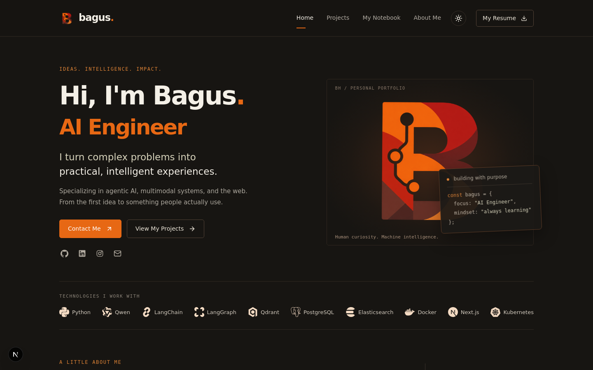
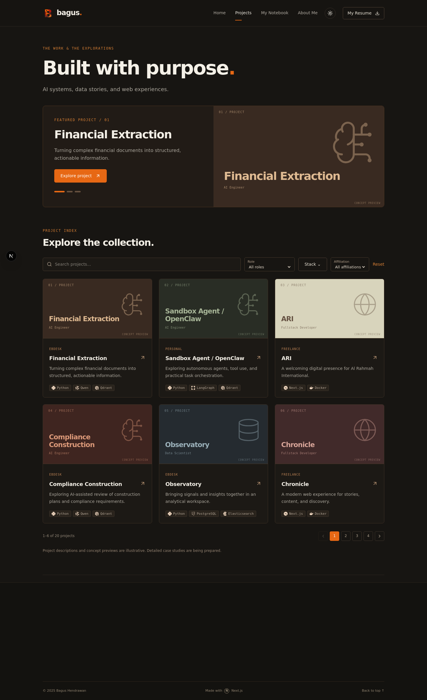
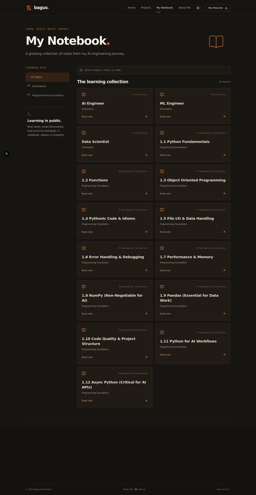
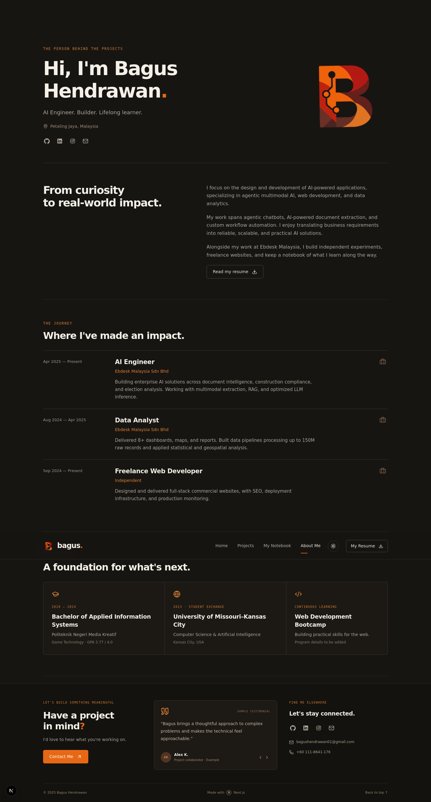
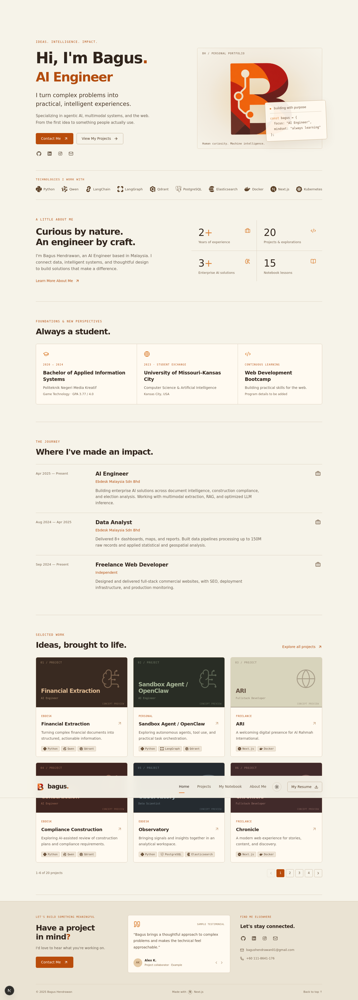

# Bagus Hendrawan — Portfolio

A standalone **Next.js App Router + React + TypeScript** portfolio site for Bagus Hendrawan, an AI Engineer based in Petaling Jaya, Malaysia. It presents his background, work, and learning notes in a single, self-contained website: no database, no CMS, no API keys, and no external accounts. All content (projects, notebook lessons, and the technology list) lives in plain JSON/Markdown files under `content/`, is validated with Zod at build time, and rendered by the server into static pages.

## What it looks like

The design is a dark, warm "Fireside" theme (near-black `#171512` background, cream `#f4f0e7` text, burnt-orange `#e76814` accents) with a monospace eyebrow typography, an orange circuit-style "B" monogram, and gentle scroll-reveal motion. A light theme (warm cream background) is available via the sun/moon toggle in the header, and the choice is remembered between visits.

**Home** — hero with a rotating role title ("AI Engineer / Data Scientist / Full Stack Developer"), a code-card monogram artwork, the technology strip, an about-summary with stats, education, work history, and a grid of selected projects.



**Projects** — "Built with purpose." intro, an auto-rotating featured-project banner, and a filterable, searchable, paginated grid (6 per page) of all 20 projects, each card showing an affiliation, description, and tech-stack tags. Clicking a card opens a detail dialog.



**My Notebook** — a searchable collection of Markdown lessons grouped by topic (Orientation, Programming Foundation, …) with a topic sidebar; clicking a card opens the full lesson in a Markdown reader dialog.



**About Me** — the person behind the projects: location, story, resume link, work history timeline, and education cards.





## Run locally

Use Node.js **22.13+** (Node 22 LTS recommended) and npm.

```bash
npm ci
npm run dev
```

Open http://localhost:3000. For another port:

```bash
npm run dev -- --port 3100
```

## Check and build

```bash
npm run content:check
npm run typecheck
npm run build
npm start
```

`build` uses standard Next.js with webpack for predictable cross-platform builds. No Sites, Cloudflare, Vinext, database, API keys, or account connection is required. `npm start` serves the production build on port 3000.

## Structure

```text
content/
  projects/                 One JSON file per project
  notebook/
    orientation/            Markdown lessons with YAML metadata
    programming-foundation/
  technologies.json         Stack names, local logo paths, homepage visibility
public/
  icon.png                  Personal B logo
  bagus-hendrawan-resume.pdf
  tech/                     Local brand SVGs and source credits
src/
  app/                      Home, projects, notebook, about routes and global styles
  components/
    portfolio/              Portfolio UI and reusable visual components
    ui/                     Dialog, checkbox and button primitives
    theme-provider.tsx
  lib/content.ts            Server-side content entry point
  types/content.ts          Content interfaces
scripts/
  content.mjs               Shared recursive loader and Zod validation
  check-content.mjs         Content validation CLI
 templates/                 Copyable project and lesson examples
```

## Add a project

1. Copy `templates/project.json` to `content/projects/21-my-project.json`.
2. Choose a unique numeric `id` and lowercase hyphenated `slug`.
3. Edit `name`, `desc`, `role`, `affiliation`, and `stack`.
4. Optionally add a screenshot under `public/projects/`, then set `image` to `/projects/my-project.webp` and write meaningful `imageAlt` text.
5. Set `url` to the real website URL, or keep `null` to show the email CTA.
6. Set `featured: true` to include the project in the banner. The first **three** featured projects by `order` appear there.
7. Run `npm run content:check`.

Project filters, counts, and pagination update from the files automatically. Lower `order` values appear first. The filename is for organization; `order` controls display order. `draft: true` hides an entry but still validates it. `isPlaceholder: true` shows the sample-description notice in its dialog. Missing images use the existing concept preview.

Roles and affiliations are unrestricted nonempty strings; their filter options are derived from published projects. Stack names must match entries in `content/technologies.json` exactly. Selecting several stacks matches projects that include **all** selected stacks.

## Add a notebook lesson

1. Copy `templates/notebook.md` anywhere under `content/notebook/`, including a new subfolder.
2. Set a unique `id` and `slug`, a `title`, `topic`, and numeric `order` in the YAML frontmatter.
3. Write the lesson below the closing `---` using Markdown.
4. Run `npm run content:check`.

All subfolders are scanned recursively. Topics are derived from published lesson metadata, so a new topic automatically appears in the topic filter. Search includes the title and full lesson text. Supported Markdown includes headings, lists, links, images, fenced code blocks, blockquotes, and GitHub-style tables and task lists. Raw HTML is not rendered. The title is displayed by the reader dialog, so a top-level `#` heading in the body is hidden to avoid duplication.

Use absolute public image paths such as ``. Use external URLs for reference links; Notion-export-relative links do not automatically become application routes. Lessons currently open in dialogs, not individual URL pages.

## Add a technology

Add a local SVG under `public/tech/` and an entry to `content/technologies.json`:

```json
{ "name": "My Stack", "icon": "/tech/my-stack.svg", "showOnHome": true }
```

Use the exact `name` in project `stack` arrays. Logos are monochrome to fit both themes. Brand credits are in `public/tech/SOURCES.txt`.

## Edit personal information and appearance

- Resume: replace `public/bagus-hendrawan-resume.pdf`.
- Social URLs: `src/components/portfolio/social-links.tsx`.
- Hero, biography, contact/footer text, testimonials: `src/components/portfolio/portfolio.tsx`.
- Work history: `src/components/portfolio/experience.tsx`.
- Education: `src/components/portfolio/education.tsx`.
- Theme colors, layout and motion: `src/app/globals.css`.
- Browser title and description: `src/app/layout.tsx`.

The existing 20 project descriptions and testimonials remain illustrative. Replace them before using them as verified case studies or endorsements. The bootcamp detail is still a placeholder. The included PDF contains the original resume contact details.

## Content updates and deployment

### Upload images and videos to S3

Put the images and videos under `public/`, then set `AWS_REGION` and `S3_BUCKET_NAME` in `.env` along with AWS credentials (or use your normal AWS credential chain). Run:

```bash
npm run media:upload
```

The command uploads all images and videos under `public/` to stable `portfolio/` keys in S3, checks that each public URL is readable, then replaces local references in site content and source files. It removes those media files from Git tracking but keeps local copies ignored by Git. The resume PDF and `docs/screenshots/` are excluded. Re-run the command after adding or changing media.

The AWS identity running the command needs `s3:PutObject` on `portfolio/*` in the bucket, and the bucket must allow public `s3:GetObject` access to those objects. The command does not change AWS permissions. The two existing project videos use Git LFS. If this checkout contains LFS pointers, the command restores the real videos from the local LFS cache before upload. If those cached objects are missing, run `git lfs pull` and retry. Upload or public-access failures leave site links and Git tracking unchanged. Commit the updated content, source, `.gitignore`, `.gitattributes`, and removal of media from Git after a successful run.

New project screenshots and technology logos can still be placed under `public/` locally and referenced by `/path`; run `npm run media:upload` to publish them and replace their links before deployment.

Content is read on the server and included when pages are built. During development, refresh the page after editing content (restart the dev server if adding a new file is not detected). For production, rebuild and redeploy after changes. Files are not editable through the website.

Deploy to any host that supports a standard Node.js Next.js application (for example Vercel or a Node server). The config includes content files in Next's output tracing. The project has no authentication; if you deploy it on a public host, it is public unless you configure access controls there.

The ZIP intentionally excludes `node_modules`, `.next`, Git history, credentials, hosting metadata, and build caches. Install dependencies with `npm ci` using the included lockfile.
